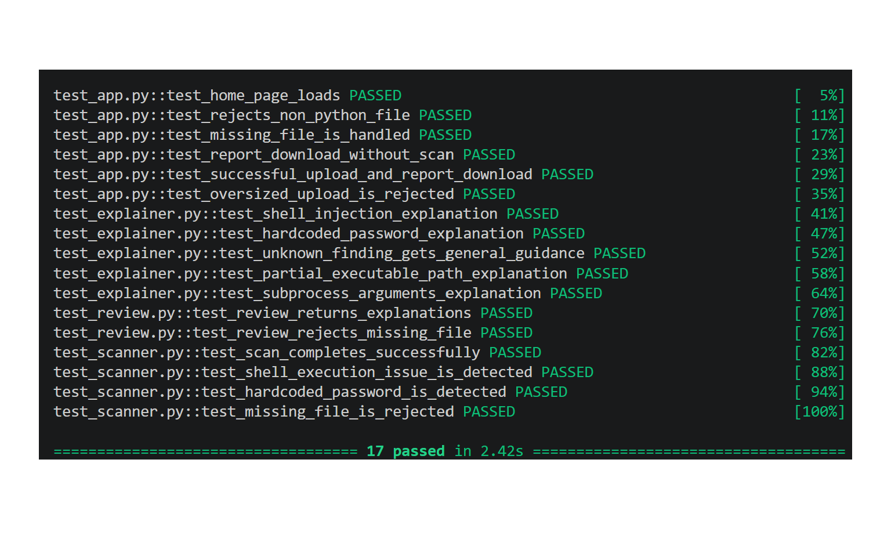

# 🔐 Secure Code Review Assistant

### Understand security warnings. Learn safer Python. Review your code with confidence.

A beginner-friendly web application that scans Python files for potential security issues and explains selected findings in simple language.

**Built with Python, Flask, and Bandit.**

<p align="center">
  <a href="https://github.com/pavanij-10/secure-code-review"><strong>📂 View Source Code</strong></a>
  ·
  <a href="#-getting-started"><strong>🚀 Get Started</strong></a>
  ·
  <a href="#-how-it-works"><strong>⚙️ How It Works</strong></a>
  ·
  <a href="#-testing"><strong>🧪 Testing</strong></a>
</p>

---

## 👋 What is this project?

Security scanners can report potentially unsafe code, but their findings may be confusing when you're just starting to learn Python or cybersecurity.

The **Secure Code Review Assistant** makes those findings easier to understand.

Upload a Python file through a simple web interface. The application uses Bandit to scan the code, adds custom explanations and recommendations for selected findings, and presents the results in an HTML report.

> 🎯 **Our goal:** Make Python security findings easier for beginners to understand—not replace professional security analysis.

## ✨ What can it do?

| Feature | What it means for you |
|---|---|
| 🔎 Static security scanning | Identify potential security issues using Bandit |
| 💡 Custom explanations | Understand selected warnings in simpler language |
| 🛠️ Remediation guidance | Learn what to review or change |
| 🧩 Secure-code examples | See example patterns for selected findings |
| 📊 HTML reports | Review findings, severity summaries, and recommendations in one report |
| 📤 Python file upload | Submit a `.py` file through the browser |
| 🧪 Automated tests | Check important application behavior with pytest |

## ⚙️ How it works

```text
📄 Choose a Python file
          ↓
🔎 Bandit scans the code
          ↓
💡 Selected findings receive explanations
          ↓
🛠️ Recommendations and examples are added
          ↓
📊 Review the results in the web interface
          ↓
📥 Download the HTML report
```

The scanner identifies potential issues. The assistant organizes and explains selected findings so they are easier to review.

## 🖥️ Try it on your computer

You can run the application locally. No online deployment is required.

### 1. What you'll need

- Python installed
- Git installed
- A terminal such as Windows PowerShell
- An internet connection to install the Python packages

### 2. Download the project

Open PowerShell and run:

```powershell
git clone https://github.com/pavanij-10/secure-code-review.git
cd secure-code-review
```

### 3. Create a virtual environment

```powershell
python -m venv .venv
.\.venv\Scripts\Activate.ps1
```

If PowerShell blocks activation, use Command Prompt to activate the environment instead:

```bat
.venv\Scripts\activate.bat
```

### 4. Install the dependencies

```powershell
python -m pip install flask bandit pytest
```

### 5. Start the application

```powershell
python app.py
```

Open this address in your browser:

**http://127.0.0.1:5000**

Keep the terminal open while you use the application.

### 6. Upload a Python file

1. Click **Choose file**.
2. Select a Python source file ending in `.py`.
3. Click **Review Code**.
4. Read the findings and recommendations.
5. Download the HTML report if you need a copy.

**Upload limit:** The application is configured for a maximum request size of 1 MB.

## 🧠 Understanding the findings

A finding is a warning that a code pattern may need attention. It does not automatically mean that the program is exploitable.

For example, Bandit may report the use of `shell=True` in a subprocess call because untrusted input could allow unintended commands to execute.

A safer approach often uses an argument list with `shell=False`, but the correct fix depends on the program's requirements and input handling.

**Remember:** Review the actual code and its context before applying a recommendation.

## 🧪 Testing

The project includes automated tests for:

- Homepage behavior
- Python upload handling
- Rejection of non-Python files
- Missing file handling
- Security finding explanations
- Review logic
- Report downloads
- Oversized upload rejection

Run the test suite with:

```powershell
python -m pytest -v
```

**Latest recorded result:** 17 tests passed.

You can rerun the tests after making changes to verify that important behavior still works.

## 🗂️ Project structure

```text
secure-code-review/
├── app.py                        # Flask web application
├── scanner.py                    # Bandit scanning integration
├── explainer.py                  # Custom explanations and examples
├── review.py                     # Review and finding enrichment
├── report.py                     # HTML report generation
├── run_review.py                 # Local review runner
├── templates/
│   └── index.html                # Web interface template
├── sample_safe.py                # Example safer-pattern sample
├── sample_vulnerable.py          # Example vulnerable sample
├── sample_vulnerable_baseline.py # Baseline sample
├── test_app.py                   # Web application tests
├── test_explainer.py             # Explanation tests
├── test_review.py                # Review logic tests
├── test_scanner.py               # Scanner tests
├── index.html                    # Additional HTML file
├── .gitignore
└── README.md
```

## 🧰 Technologies used

- **Python** — application logic
- **Flask** — web interface and file uploads
- **Bandit** — Python static security analysis
- **HTML/CSS** — page and report presentation
- **pytest** — automated testing
- **Git and GitHub** — version control and source hosting

## ⚠️ Current limitations

- The project focuses on Python source files.
- Bandit performs the security detection; this project adds a custom review and learning layer.
- Custom explanations and secure-code examples cover selected findings, not every possible rule.
- Static analysis can produce false positives and miss issues requiring broader context or runtime testing.
- Recommendations and example code should be reviewed before being used in a real application.
- The local Flask development server is intended for development and testing, not public production use.

## 🛣️ Future improvements

Potential improvements include:

- Showing more source-code context beside findings
- Improving the readability of long code examples in HTML reports
- Comparing findings between two scans
- Expanding beginner-friendly explanations
- Evaluating the tool against a documented collection of Python examples

These are possible future improvements, not features currently claimed as implemented.

## 🎓 Who is this for?

This project is intended for:

- Students learning Python
- Beginners exploring cybersecurity
- Learners practicing secure coding
- Anyone who wants to understand selected Bandit findings more clearly

## 📌 Project status

**Version 1 — Initial working implementation**

Built as a learning-focused project exploring Python static analysis, Flask, report generation, and automated testing.

## 🔒 Responsible use

Use this application on code you own or have permission to review. Do not upload confidential or sensitive source code to services you do not control.

This tool supports learning and preliminary review. It does not guarantee that code is secure.

---

<p align="center">
  <strong>Built to make secure coding easier to understand. 💙</strong>
</p>


## 🧪 Test Evidence

The project includes automated tests for the scanner, security explanations, review logic, and web application.

**Latest test result: 17 passed**


